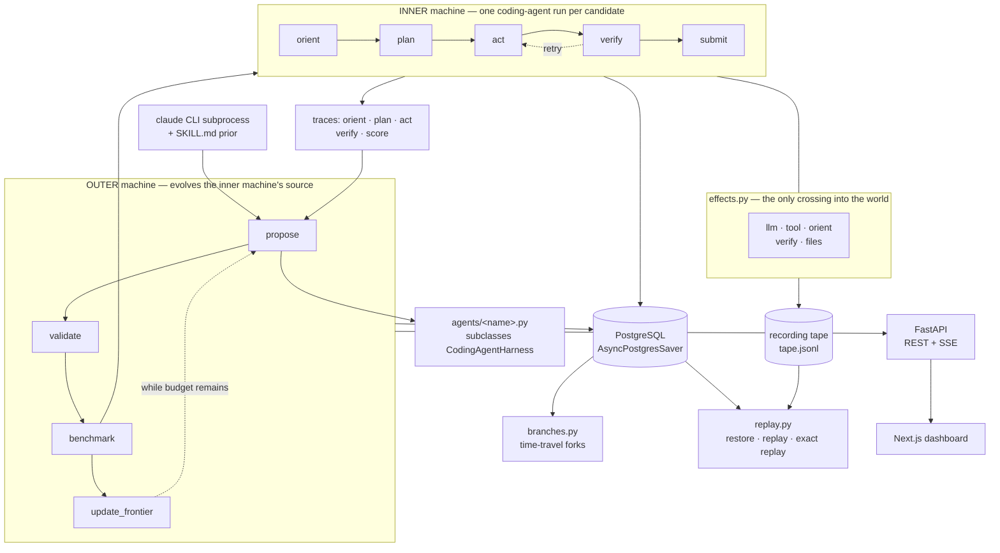

# Meta-Harness

**A LangGraph-native substrate for self-improving coding-agent harnesses,
where the optimisation history is a durable, branchable, exactly-replayable
object rather than a log file.**

An outer agent reads the raw execution traces of an inner coding agent and
rewrites that agent's *source code*. That is the Meta-Harness paradigm
([Lee et al., project page](https://yoonholee.com/meta-harness/)). What
this repository adds is the substrate underneath it: both loops are
LangGraph state machines checkpointed into PostgreSQL, so the search is a
tree you can rewind, fork and re-execute, not a sequence you can only read
about afterwards.

---

## What it does

The paper's loop is **linear**: iteration 1 → 2 → 3 → 4, each proposal
conditioned on the last. Real harness optimisation is not linear. You want
to rewind to iteration 2, give the proposer a different prior, and run
both continuations side by side.

Mapping both loops onto LangGraph state machines makes four properties
fall out of the substrate rather than out of bespoke plumbing:

| Property | Mechanism |
|---|---|
| **Isolated** | Each trial runs in a fresh temp workspace; every artifact a branch writes is scoped to its LangGraph thread, so two concurrent branches cannot overwrite each other |
| **Recoverable** | Every state transition is checkpointed via `AsyncPostgresSaver`; any checkpoint restores to byte-identical state, provable by SHA-256 |
| **Reversible** | Time travel via `get_state_history` + `update_state` + `ainvoke(None, ckpt_id)`, with branch metadata persisted to disk so it survives a restart |
| **Replayable** | A recorded run re-executes from any of its stored checkpoints against its tape: same transitions, same final state byte-for-byte, zero model calls |

Around that core: a Pareto frontier over accuracy × measured tokens,
cross-run memory that carries patterns from one run into the next, a
two-arm benchmark protocol with search/holdout isolation and cluster-aware
statistics, optional Weights & Biases tracking, a FastAPI backend that
streams events over SSE, and a Next.js dashboard that renders the search
tree live.

---

## Architecture

Two nested state machines. The **outer** one
([`outer.py`](backend/app/meta_harness/outer.py)) evolves the inner one's
source code, its `propose` node spawning a `claude` CLI subprocess that
reads the branch's own traces, evolution log and Pareto frontier before
writing a new `agents/<name>.py`. The **inner** one
([`inner.py`](backend/app/meta_harness/inner.py)) is one coding-agent run
per candidate.



**A fixed contract, an evolvable shape.** The six tools in `tools.py`
(`read_file`, `apply_patch`, `write_file`, `run_bash`, `grep_search`,
`task_complete`) are the contract with the evaluator. The search space is
the **11 override points** on `CodingAgentHarness` — turn budget, retry
policy, system prompt, plan template, tool-result formatting, the
`verify → act` loop-back predicate, and how the five phases are wired
(`_wire_inner_graph`). A candidate subclasses it and overrides a subset.

**Grading is outside the agent's reach.** The agent's own verify step
only drives its retry loop. The score comes from
[`grading.py`](backend/app/meta_harness/grading.py): a fresh copy of the
task's pristine workspace into which only the files the task lists in
`expected_files_changed` are carried, then the task's tests. An agent
that edits a test, adds a `conftest.py` or touches any other file gains
nothing, so the outer loop cannot evolve a harness that games its own
score.

**Every crossing into the world goes through `effects.py`** — model calls,
tool dispatch, the workspace scan, the verify subprocess, the final-file
snapshot, every trace write. That single boundary is what makes exact
replay possible: under `--record` each crossing is appended to a tape, and
replay re-executes the real graph, nodes and tools with every effect
served from the tape instead of the world. It fails loudly unless all five
hold — `no_divergence` · `node_sequence_identical` ·
`per_step_state_hashes_identical` · `final_state_byte_identical` ·
`tape_fully_consumed`.

Four operations are called "replay"; only one earns the unqualified phrase
*exact replay*:

| Command | Executes? | Model calls | Guarantee |
|---|---|---|---|
| `replay <run>` | no | none | the recorded transitions, in order |
| `replay <run> --checkpoint <id>` | no | none | that checkpoint's exact state, provable by SHA-256 |
| `replay <run> --checkpoint <id> --verify` | **yes** | **none** | same nodes, same per-step state hashes, same final state byte-for-byte |
| `resume <run>` | yes | **fresh** | a new stochastic execution from an old state — *not* reproducible |

---

## Tech stack

| Component | Choice |
|---|---|
| State machines | LangGraph 1.x (`langgraph>=0.2`, locked at 1.1.9) |
| Checkpointer | `AsyncPostgresSaver` (langgraph-checkpoint-postgres) |
| Database | PostgreSQL 16 |
| Containers | Docker + Compose — multi-stage, non-root, healthchecked backend image beside Postgres |
| Backend API | FastAPI 0.115+ + Uvicorn, with Pydantic 2 request models and an SSE event stream |
| Inner-loop LLM | Claude Haiku 4.5 by default; override with `META_HARNESS_INNER_MODEL` |
| Proposer | Claude Code CLI subprocess, primed with `SKILL.md` via `--append-system-prompt` |
| Experiment tracking | Weights & Biases, optional — disabled, offline and online modes |
| CLI | Typer + python-dotenv |
| Frontend | Next.js 16, Tailwind 4, D3, Monaco, optional Auth0 |
| Workspace tooling | uv (workspace mode: `sdk/` + `backend/`) |
| Testing | pytest, pytest-asyncio, Playwright |

---

## Run it locally

**Prerequisites** — Python 3.11+ and [uv](https://github.com/astral-sh/uv),
Docker (for Postgres), Node.js 20+ (for the dashboard). Live runs also need
an `ANTHROPIC_API_KEY` and the
[Claude Code CLI](https://docs.anthropic.com/en/docs/claude-code/overview)
(`claude`) for the real proposer.

```bash
git clone https://github.com/davidyang07/Meta-Harness.git
cd Meta-Harness
cp .env.example .env                                 # ANTHROPIC_API_KEY for live runs
uv sync
docker compose -f infra/docker-compose.yml up -d postgres

make verify                                          # everything provable without credentials
```

The loop and the dashboard run with no API key and no cost — synthetic
scores are labelled `metrics_source: "mock"` everywhere they surface:

```bash
uv run meta-harness loop --proposer mock --mock-bench --budget 2 --fresh

uv run meta-harness serve --port 8000                # terminal 1
cd frontend/dashboard && npm install && npm run dev  # terminal 2
```

> Start the backend with `meta-harness serve`, never a bare
> `uvicorn app.main:app`: uvicorn selects Windows' `ProactorEventLoop`,
> which psycopg cannot use. `GET /health` reports `persistence` and
> `persistence_error`, so a degraded backend is never silent.
>
> `serve` binds `127.0.0.1` by default. To bind anything else, set
> `META_HARNESS_API_TOKEN`: every route except `GET /health` then needs
> `Authorization: Bearer <token>`, and the dashboard sends it from
> `NEXT_PUBLIC_META_HARNESS_API_TOKEN` (see
> [`frontend/dashboard/.env.example`](frontend/dashboard/.env.example)).

With credentials, the same loop runs against live models, and the whole
stack runs in Docker:

```bash
uv run meta-harness inner --task task-001-fix-typo --candidate baseline
uv run meta-harness loop --proposer claude --budget 1 --fresh --mock-bench

export META_HARNESS_API_TOKEN=$(openssl rand -hex 24)        # the container binds 0.0.0.0
docker compose -f infra/docker-compose.yml up -d --build    # postgres + backend, both on 127.0.0.1
```

The image runs the mock proposer out of the box. To run the real
proposer inside it, build with `--build-arg INSTALL_CLAUDE_CLI=1`.

### Other commands worth knowing

```bash
uv run meta-harness checkpoints <run>             # checkpoint history
uv run meta-harness fork <run> --checkpoint <id> --mod proposer_prior="try X"
uv run meta-harness resume <run>                  # FRESH model calls; not a replay

uv run meta-harness inner --task task-001-fix-typo --candidate baseline --record
uv run meta-harness replay <run> --checkpoint <id> --verify    # exact replay
uv run meta-harness verify-replay runs/<run>

uv run meta-harness benchmark --candidate <name> --trials 5
uv run meta-harness canonical-experiment --dry-run  # plan + cost, spends nothing
uv run meta-harness canonical-experiment            # evolve → select → measure → report (--fresh to wipe a prior run)
uv run meta-harness report version-graph <run>      # the checkpoint DAG as evidence
uv run meta-harness memory list                     # cross-run patterns

uv sync --extra wandb                               # optional W&B tracking, off by default
WANDB_MODE=offline uv run meta-harness loop --wandb --proposer mock --mock-bench --budget 2
```

### Tests

```bash
make verify                                # the full credential-free ladder
make verify-fast                           # skips the Docker and dashboard builds
ONLY=postgres bash scripts/verify.sh       # one stage
cd backend && uv run pytest tests/ -q      # the suite alone
make verify-evidence                       # the evidence artifacts re-derive and stay portable
make e2e                                   # Playwright: offline demo + scripted backend
```

`make verify` covers the backend suite, the Postgres-backed suites, replay,
branching, benchmark protocol validity, W&B offline, evidence freshness
(the capability document re-derives and no evidence artifact names a
local path), the Docker image, repository hygiene and the dashboard
build. An unknown `ONLY=` stage or a missing tool fails rather than
passing; only an explicit `SKIP_*=1` skips a stage. CI runs the same ladder on
every push with `ANTHROPIC_API_KEY` deliberately empty, plus Playwright
end-to-end projects against fixtures and a live backend.

---

## Evaluation

Two committed protocols: [`benchmarks/pass-rate/`](benchmarks/pass-rate/)
runs 10 frozen search tasks × 10 independent trials × 2 arms (200
trials), and [`benchmarks/holdout/`](benchmarks/holdout/) runs 5 unseen
tasks × 10 trials × 2 arms for generalisation. Task instructions state
the symptom or requirement, never the fix, and every task is checked to
fail as shipped. The two arms' trials are interleaved, so drift over the
run cannot masquerade as a difference between them. Candidate selection
uses only the validation accuracy measured *during* evolution, so the
final experiment's trials cannot influence which candidate they measure.

Every reported field is derived from the raw `*-results.jsonl` rows by
`experiment.summarize()`: pass rates with pass and trial counts and a
Wilson interval per arm, the absolute percentage-point delta with a
Newcombe interval, per-task outcomes, a task-cluster bootstrap 95%
interval under a deterministic seed, and tokens, cost and wall time. A
trial that crashes is recorded as an `error` row and counted, never
silently dropped and never allowed to abort the run. The guards are tests, not conventions — no target can reach the
computation, mock rows cannot become results, and CI re-derives every
published summary from its committed rows.

---

## Repository layout

```
meta-harness/
├── backend/app/
│   ├── cli.py · main.py · api/                # CLI, FastAPI app, REST + SSE routers
│   └── meta_harness/
│       ├── outer.py · inner.py · state.py     # the two state machines + schemas
│       ├── harness.py · tools.py · grading.py # 11 override points, 6 fixed tools, the grader
│       ├── proposer.py · candidates.py        # claude CLI proposer, per-branch snapshots
│       ├── benchmark.py · metrics.py          # measured trial core, tokens + cost
│       ├── experiment.py · pipeline.py        # two-arm protocols, evolve → measure → report
│       ├── effects.py · recording.py · replay.py
│       ├── branches.py · versioning.py · persistence.py · runs.py
│       └── frontier.py · memory.py · tracking.py · sandbox.py
├── frontend/dashboard/                        # Next.js 16 dashboard (+ e2e/)
├── benchmarks/                                # committed protocols + published results
├── eval/tasks/ · eval/holdout/                # 10 frozen search tasks, 5 unseen tasks
├── agents/baseline.py                         # the immutable starting harness
├── sdk/meta_harness/                          # public Python library
├── skills/meta-harness-coding-agent/SKILL.md  # the proposer's injected workflow
└── scripts/ · infra/ · docs/                  # verify ladder, Docker, contracts (docs/history: design records)
```

Execution state is thread-scoped, which is what makes concurrent branches
safe:

```
runs/<run_id>/
├── manifest.json                      # run config + metrics_source
├── branches.json                      # durable branch metadata (survives restart)
└── threads/<thread_id>/
    ├── pending_eval.json              # this branch's propose → benchmark handoff
    ├── frontier_val.json              # this branch's Pareto frontier
    ├── evolution_summary.jsonl        # this branch's candidates
    ├── agents/<candidate>.py          # what this branch actually benchmarked
    ├── candidates/<candidate>/        # eval-result.json, status.json, traces/
    └── proposer-sessions/iter-N/      # transcript, events, session.json
```

---

## Security posture

Sandboxing is **process isolation only**, so treat a run as "this repo
executes model-written code":

- **Trials** run in a fresh temp-directory workspace with a wall-clock
  timeout, in their own process group so a timeout kills background
  children too, with `RLIMIT_CPU` / `RLIMIT_AS` on Unix, and with
  credentials (`ANTHROPIC_API_KEY`, `*_TOKEN`, `*_SECRET`, `POSTGRES_DSN`,
  …) scrubbed from the environment. `run_bash` can still reach the rest
  of the filesystem; grading in a pristine copy (above) is what keeps
  that from affecting the score.
- **The proposer** runs `claude --dangerously-skip-permissions` in a
  staged copy of the repository that omits `eval/holdout/`, published
  results and other branches' runs. `eval/` and `benchmarks/` are hashed
  before and after, and the transcript is audited for holdout paths; a
  hit voids the iteration. This detects leakage, it is not an OS
  sandbox: a model that names an absolute path outside the stage can
  still read it.
- **The API** binds loopback by default and requires
  `META_HARNESS_API_TOKEN` for anything else. Path inputs arriving over
  HTTP are pattern- and containment-checked, and a skill path must
  resolve to `skills/<name>/SKILL.md`. Compose publishes both ports on
  `127.0.0.1` only.
- **Eval `test_command`s** run with `shell=True` as trusted repository
  content.

---

## Acknowledgments

- Yoonho Lee, Roshen Nair, Qizheng Zhang, Kangwook Lee, Omar Khattab and
  Chelsea Finn — *Meta-Harness: End-to-End Optimization of Model
  Harnesses*, [project page](https://yoonholee.com/meta-harness/), and
  the reference framework at
  [stanford-iris-lab/meta-harness](https://github.com/stanford-iris-lab/meta-harness).

## License

MIT — see [LICENSE](LICENSE).
